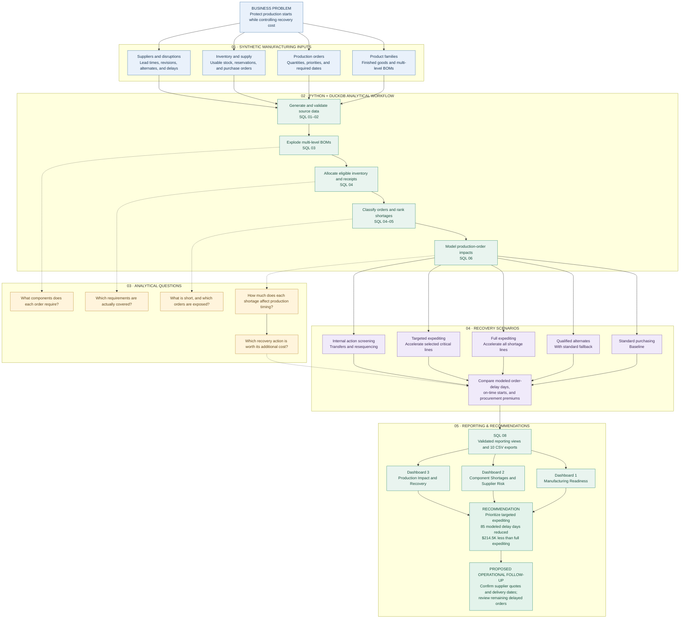
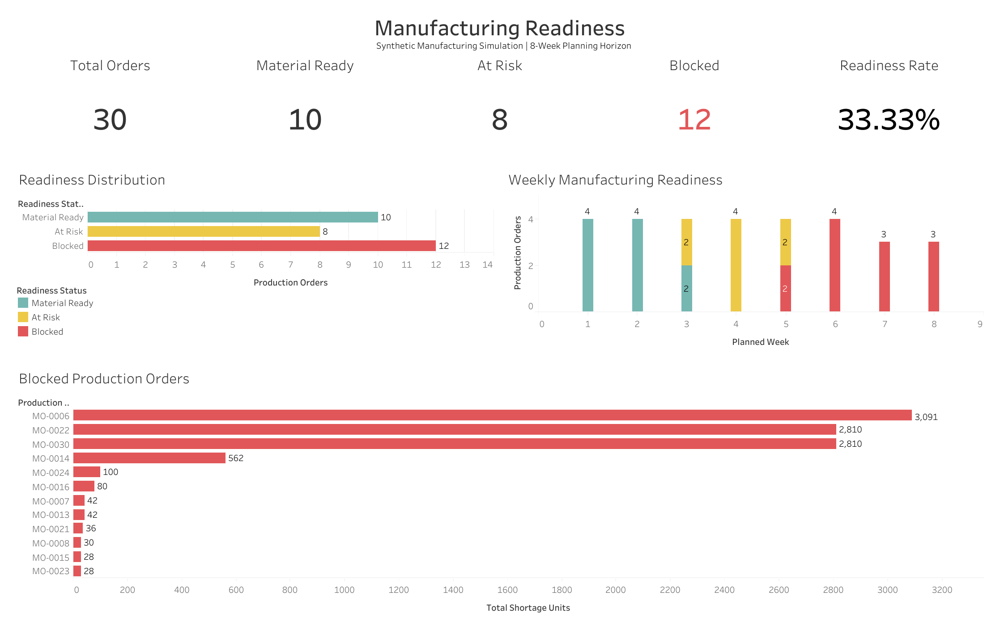
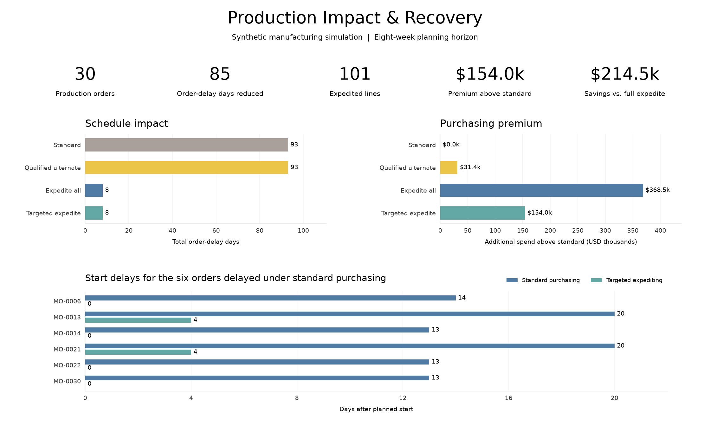

# Manufacturing Readiness & Shortage Intelligence

**Python · DuckDB SQL · Tableau · Manufacturing Analytics · Material Planning · Procurement Recovery**

*An end-to-end supply chain decision-support project for a simulated aerospace electronics manufacturer.*

## Project Overview

Manufacturing readiness depends on more than having a production schedule. Before an order can begin, planners must verify that the required components are available, evaluate incoming supply, identify shortages, and determine whether procurement interventions can protect planned production dates.

This project develops a manufacturing readiness and shortage intelligence workflow that connects **multi-level bills of materials (BOMs), inventory allocations, purchase orders, component shortages, and production recovery scenarios**.

The central business question is:

> How can a manufacturing planning team identify material constraints early, prioritize critical shortages, and recover production schedules without paying unnecessary expediting premiums?

Using a synthetic eight-week manufacturing scenario, the analysis identifies **12 blocked production orders**, evaluates four procurement recovery strategies, and finds that selectively expediting **101 of 424 shortage lines** achieves the same modeled production timing as blanket expediting at **$214,500.11 less procurement cost**.

All underlying suppliers, production orders, quantities, pricing, and financial outcomes are simulated. Results demonstrate a decision-support methodology, not realized company performance.

**Explore the project:** [Executive Summary](docs/executive_summary.md) · [Methodology](docs/methodology.md) · [Reporting Data](data/reporting/) · [Tableau Workbook](dashboards/Manufacturing_Readiness_Intelligence.twb)

---

## 1. Executive Summary

### Key Results

| Business Metric | Validated Result |
|---|---:|
| Production orders analyzed | **30** |
| Planning horizon | 8 weeks |
| Product families | 4 |
| Suppliers modeled | 8 |
| Material-ready production orders | **10** |
| At-risk production orders | 8 |
| Blocked production orders | **12** |
| Baseline material readiness | **33.33%** |
| Distinct short components | 109 |
| Critical short components | 55 |
| Shortage exception lines | 424 |
| Missing component units | 9,659 |
| Modeled missing material value | $1,473,979.95 |
| Baseline aggregate order-delay days | 93 |
| Targeted recovery aggregate order-delay days | 8 |
| **Modeled delay reduction** | **85 order-delay days** |
| Shortage lines selected for expediting | 101 |
| Targeted incremental procurement spending | $154,010.01 |
| **Modeled savings vs. full expediting** | **$214,500.11** |

### Executive Recommendation

**Prioritize targeted expediting over blanket expediting under the modeled assumptions.**

Both strategies reduce aggregate production-order delays from 93 days to 8 days, but targeted expediting requires approximately **58.2% less incremental spending** than expediting all shortage lines.

The recommended planning response is to prioritize components that constrain production starts, confirm recoverability with suppliers, and accelerate only those shortage lines necessary to achieve the modeled recovery dates.

The remaining two delayed production orders should receive additional attention because the evaluated purchasing interventions do not fully restore their planned starts.

**Decision supported:** A targeted procurement recovery plan that balances material readiness, schedule protection, and incremental purchasing cost.

---

## 2. Business Context & Problem Statement

### Manufacturing Environment

The project models an aerospace electronics manufacturer operating across an eight-week planning horizon, beginning January 4, 2027.

The simulated production environment contains:

| Manufacturing Element | Scope |
|---|---|
| Finished products | 4 |
| Subassemblies | 24 |
| Purchased components | 400 |
| Production orders | 30 |
| Suppliers | 8 |
| Planning period | January 4 – February 28, 2027 |
| Core analytical platform | Python and DuckDB SQL |
| Decision reporting | Tableau |

A single finished product depends on many lower-level assemblies and purchased components. Component shortages can therefore affect multiple production orders, even when finished-product demand appears manageable.

The manufacturer must coordinate engineering requirements, available inventory, purchasing schedules, and production priorities to determine which orders can start.

### The Planning Challenge

Traditional shortage reporting can identify missing inventory, but it does not necessarily answer the operational questions that matter most.

For example, a component shortage of 200 units may be less urgent than a shortage of 20 units if the smaller shortage blocks a high-priority production order scheduled to start tomorrow.

Likewise, expediting every shortage may improve material availability but unnecessarily increase procurement spending.

The planning team must distinguish between:

1. **Material availability:** Which orders have sufficient usable inventory?
2. **Shortage exposure:** Which components and suppliers are constraining production?
3. **Production impact:** Which shortages actually delay order start dates?
4. **Recovery feasibility:** Which procurement interventions improve those dates?
5. **Economic trade-offs:** Which strategy achieves the required recovery at a reasonable incremental cost?

### Business Objective

Build a traceable analytical workflow that converts raw manufacturing and procurement records into actionable production-readiness assessments and recovery decisions.

The intended users are material planners, buyers, manufacturing operations teams, and supply chain decision-makers.

---

## 3. My Analytical Approach & Thought Process

Rather than beginning with dashboards, I structured the project around the sequence of decisions a manufacturing planner needs to make.

| Stage | Question I Wanted to Answer | Analytical Response |
|---|---|---|
| 1. Understand demand | What must be built, and when? | Connect production orders to finished-product requirements and dates |
| 2. Translate demand | Which lower-level components are required? | Explode multi-level BOMs into component-level demand |
| 3. Validate supply | What inventory and incoming receipts are actually usable? | Apply stock eligibility, reservations, and receipt timing rules |
| 4. Classify readiness | Which production orders can proceed? | Assign material-ready, at-risk, and blocked statuses |
| 5. Prioritize shortages | Which missing parts matter most operationally? | Rank shortage exposure using urgency, lead time, and affected orders |
| 6. Assess production impact | How do shortages affect production starts? | Model order delays under standard purchasing |
| 7. Evaluate interventions | What happens if purchasing is accelerated or alternates are considered? | Compare procurement recovery scenarios |
| 8. Recommend action | Which intervention provides the best modeled trade-off? | Compare delay recovery, incremental spending, and remaining risk |
| 9. Communicate findings | How can planners understand and act on the results? | Publish validated reporting datasets and executive Tableau dashboards |

### System Architecture & Decision Flow

The following Mermaid diagram presents both the technical architecture and the reasoning used to move from a manufacturing problem to a procurement recommendation.



**How to read the diagram:** The workflow separates input preparation, implemented analytical calculations, business questions, modeled recovery alternatives, and reporting. The final operational follow-up is a recommendation, not an implemented purchasing action.

The overall architecture was designed around one principle: **Every executive KPI should be traceable to an underlying manufacturing requirement, shortage line, production order, or recovery scenario.**

---

## 4. Manufacturing Readiness Analysis

### Business Question

**Which production orders can begin using available or incoming material, and which require intervention?**

The readiness model connects production requirements to eligible inventory and scheduled receipts.

It accounts for component-level requirements from multi-level BOMs, stock already reserved for other orders, quality-related inventory restrictions, and the timing of incoming purchase orders.

### Baseline Findings

| Material-Readiness Status | Orders | Planning Interpretation |
|---|---:|---|
| Material ready | 10 | Usable stock covers all required components |
| At risk | 8 | Material coverage depends on incoming deliveries arriving on time |
| Blocked | 12 | At least one required component remains unavailable |
| **Total** | **30** | |

Only **33.33% of production orders** are fully covered by existing usable inventory at the planning snapshot.

The model also reveals a timing problem: all eight orders in the first two planning weeks are material ready, while all four orders scheduled in week 6 are blocked.

This indicates that readiness cannot be evaluated using aggregate inventory alone. Component availability must also be assessed against each order's required material date.

### Tableau Dashboard 1 — Manufacturing Readiness



**Dashboard objectives:**

- Monitor the distribution of material-ready, at-risk, and blocked production orders.
- Identify changes in readiness across the eight-week planning horizon.
- Highlight blocked production orders with substantial missing component quantities.

**Operational implication:** Use the readiness assessment to identify which orders require purchasing follow-up before planned production release.

[Explore readiness reporting](data/reporting/readiness_orders.csv) · [Weekly readiness](data/reporting/weekly_readiness.csv)

---

## 5. Component Shortages & Supplier Risk

### Business Question

**Which material shortages create the greatest operational exposure, and where should buyers investigate first?**

A shortage line represents a missing component revision associated with a particular production order.

The analysis identifies:

| Shortage Metric | Result |
|---|---:|
| Distinct short components | 109 |
| Critical severity | 55 |
| High severity | 53 |
| Moderate severity | 1 |
| Shortage exception lines | 424 |
| Total missing units | 9,659 |
| Modeled missing material value | $1,473,979.95 |

The modeled material value represents the standard-cost value of missing components. It is **not** estimated lost revenue, lost profit, or realized financial exposure.

### Prioritization Findings

**Product-family concentration:** Power Distribution Assemblies account for **9,273 missing units**, approximately 96% of the modeled shortage volume.

**Production-order exposure:** High-priority production order `MO-0006` requires **3,091 additional component units** across 100 components.

**Supplier exposure:** Simulated Supplier 05 accounts for **2,329 missing units**, making it a useful starting point for supplier-level shortage investigation.

However, missing-unit volume alone is not sufficient to prioritize procurement actions.

The component-risk framework also considers shortage urgency, supplier lead time, affected production orders, and production priority.

### Tableau Dashboard 2 — Component Shortages & Supplier Risk


**Dashboard objectives:**

- Identify the most significant component shortages.
- Compare modeled shortage exposure across suppliers.
- Distinguish critical, high, and moderate shortage severity.
- Support a prioritized buyer investigation queue.

**Operational implication:** Focus first on components that threaten near-term or high-priority production, rather than relying exclusively on the largest missing quantities.

[Component ranking](data/reporting/shortage_priority.csv) · [Supplier exposure](data/reporting/supplier_risk.csv) · [Shortage detail](data/reporting/shortage_detail.csv)

---

## 6. Production Impact & Procurement Recovery

### Business Question

**How can purchasing interventions reduce manufacturing delays without creating unnecessary procurement premiums?**

Shortage analysis identifies the missing components. The production-impact model evaluates their consequences for manufacturing start dates.

An *aggregate order-delay day* represents one production order starting one day later than planned. Delay days are summed across orders, rather than interpreted as elapsed calendar days for the entire manufacturing program.

### Recovery Strategies Evaluated

Four procurement strategies were compared against the same underlying shortage exposure.

| Strategy | On-Time Orders | Aggregate Delay Days | Total Modeled Procurement Cost | Premium vs. Standard |
|---|---:|---:|---:|---:|
| Standard replenishment | 24 / 30 | 93 | $1,473,979.95 | $0.00 |
| Qualified alternate with standard fallback | 24 / 30 | 93 | $1,505,383.65 | $31,403.70 |
| Full expediting | 28 / 30 | 8 | $1,842,490.07 | $368,510.12 |
| **Targeted expediting** | **28 / 30** | **8** | **$1,627,989.96** | **$154,010.01** |

### Why Targeted Expediting Was Preferred

Blanket expediting accelerates every shortage line. That approach improves the modeled schedule but pays additional purchasing premiums even where standard replenishment could still meet the recovered start date.

Targeted expediting takes a more selective approach.

First, the model evaluates the production-start timing achievable when every missing line receives expedited delivery. It then identifies which lines can remain on standard purchasing lead times without delaying that achievable start.

This produces a targeted purchasing plan that accelerates only **101 of the 424 shortage lines**.

The remaining shortage lines retain standard purchasing treatment under the modeled timing rules.

### Modeled Recovery Outcome

| Recovery Metric | Result |
|---|---:|
| Baseline aggregate delay | 93 days |
| Targeted recovery aggregate delay | 8 days |
| Delay days reduced | **85** |
| On-time orders after recovery | **28 of 30** |
| Shortage lines expedited | **101 of 424** |
| Additional targeted purchasing cost | **$154,010.01** |
| Cost avoided vs. expediting every shortage line | **$214,500.11** |

Targeted expediting preserves the modeled timing benefit of blanket expediting while avoiding approximately **58.2% of its incremental procurement premium**.

### Production-Order Examples

- **MO-0006:** Expediting 25 of its 100 shortage lines recovers the modeled planned February 8 start date.
- **MO-0013:** Expediting two shortage lines reduces modeled delay from 20 days to four.
- **MO-0013 and MO-0021:** These orders account for the eight aggregate delay days remaining after targeted recovery.

These examples demonstrate why procurement prioritization should be linked to production-order constraints rather than treating every missing component as equally urgent.

### Tableau Dashboard 3 — Production Impact & Recovery



**Dashboard objectives:**

- Compare modeled delay outcomes across recovery strategies.
- Quantify incremental procurement spending.
- Identify production orders with residual delays.
- Explain the schedule-and-cost trade-off behind the targeted recovery recommendation.

**Operational implication:** Use targeted expediting as the first recovery option to investigate, subject to supplier confirmation and real-world purchasing feasibility.

[Recovery scenario totals](data/reporting/recovery_comparison.csv) · [Production-order recovery detail](data/reporting/production_recovery.csv)

---

## 7. Challenges I Addressed

The most important analytical challenges involved translating complex manufacturing requirements into credible, decision-ready results.

| Challenge | How I Addressed It | Why It Mattered |
|---|---|---|
| Multi-level BOM complexity | Used recursive BOM explosion to translate finished-product orders into lower-level component demand | Prevented incomplete or incorrectly multiplied material requirements |
| Shared inventory and competing orders | Incorporated existing reservations, available stock, receipt timing, and allocation priorities | Reduced the risk of counting the same supply against multiple orders |
| Component availability versus production readiness | Evaluated material requirements at the order level and against required dates | A facility can hold substantial inventory while still being unable to start specific orders |
| High shortage volumes with different operational consequences | Ranked shortage exposure using severity, urgency, lead times, and affected production orders | Helped distinguish high-volume shortages from production-critical constraints |
| Supplier and alternate-part constraints | Evaluated lead-time assumptions and qualified alternatives with eligibility restrictions | Prevented assuming every substitute was immediately interchangeable |
| Expediting cost versus schedule recovery | Compared consistent procurement scenarios with common baseline requirements | Exposed unnecessary spending associated with blanket expediting |
| Internal recovery feasibility | Screened inventory reallocation and order resequencing alternatives | Neither internal action produced an eligible candidate under the modeled restrictions; infeasibility was retained as a result |
| Reporting accuracy | Reconciled executive metrics, shortage detail, recovery results, and reporting exports | Supported traceability between the analytical model and Tableau dashboards |

### Most Important Analytical Lesson

**A shortage is not necessarily a production bottleneck, and a production bottleneck does not necessarily justify expediting every missing component.**

The most useful procurement decision emerges when component requirements, available supply, production timing, and recovery economics are analyzed together.

---

## 8. Operational Opportunities & Recommendations

The analysis suggests several opportunities for a manufacturing planning team. These are proposed operational actions, not actions executed within the simulation.

| Priority | Opportunity | Recommended Next Action |
|---|---|---|
| 1 | Recover constrained production starts | Review the 101 targeted expediting lines and validate supplier commitments |
| 2 | Address remaining schedule exposure | Investigate the two orders retaining eight aggregate delay days |
| 3 | Improve high-priority material readiness | Prioritize missing components for near-term and high-priority production orders |
| 4 | Strengthen supplier follow-up | Investigate suppliers associated with concentrated shortage exposure |
| 5 | Improve alternate-part readiness | Validate engineering qualification, revision compatibility, and availability before substitution |
| 6 | Establish an early-warning process | Refresh readiness, shortage, and supplier exposure views as order and receipt information changes |

### Recommended Management Action

Begin with a **buyer-led targeted recovery review**.

Confirm pricing, quantities, supplier lead times, and shipping commitments for the selected shortage lines. Escalate unresolved constraints for the remaining delayed orders, and update the material-readiness assessment as new information becomes available.

The modeled savings should be treated as a potential purchasing opportunity until actual supplier quotes and delivery confirmations establish feasibility.

---

## 9. Technical Implementation

### Technology Stack

| Layer | Tools | Purpose |
|---|---|---|
| Synthetic data generation | Python | Create reproducible manufacturing, inventory, and supplier records |
| Data storage | DuckDB | Maintain structured analytical tables |
| Data transformation | SQL | Explode BOMs, allocate supply, classify readiness, and evaluate recovery |
| Scenario analysis | Python and SQL | Compare purchasing responses and simulated order impacts |
| Data validation | Python and SQL | Reconcile integrity checks, reporting outputs, and business KPIs |
| Reporting | CSV exports | Provide traceable, dashboard-ready datasets |
| Visualization | Tableau | Communicate material readiness, shortage exposure, and recovery decisions |
| Version control | Git and GitHub | Document implementation and share deliverables |

### SQL Analytical Pipeline

| Stage | Implementation | Primary Output |
|---|---|---|
| SQL 01–02 | Database ingestion, typed records, and integrity checks | Validated manufacturing source tables |
| SQL 03 | [Multi-level BOM explosion](sql/03_material_requirements.sql) | Component-level material requirements |
| SQL 04 | [Material readiness](sql/04_material_readiness.sql) | Available supply allocations and order readiness |
| SQL 05 | [Shortage analysis](sql/05_shortage_analysis.sql) | Shortage detail and severity |
| SQL 06 | [Production impact](sql/06_production_impact.sql) | Modeled production-order delays |
| SQL 07 | Procurement recovery scenarios | Baseline and alternative purchasing outcomes |
| SQL 07B | Targeted expediting | Selective recovery and incremental spending |
| SQL 07C | Internal action screening | Inventory reallocation and resequencing feasibility |
| SQL 08 | [Dashboard reporting](sql/08_dashboard_reporting.sql) | Ten validated reporting exports |

### Repository Structure

```text
manufacturing-readiness-and-shortage-intelligence/
│
├── data/
│   ├── raw/                  # Synthetic manufacturing source data
│   ├── processed/            # DuckDB analytical database
│   ├── reporting/            # Ten validated reporting CSVs
│   └── archive/              # Archived stress-test baseline
│
├── scripts/
│   ├── data_generator.py
│   ├── generate_bom.py
│   ├── generate_production_orders.py
│   ├── generate_supply_data.py
│   ├── generate_disruptions.py
│   ├── build_database.py
│   ├── validate_database.py
│   └── run_sql*.py
│
├── sql/                      # SQL 01–08 analytical transformations
│
├── dashboards/
│   ├── Manufacturing_Readiness_Intelligence.twb
│   └── exports/
│       ├── 01_manufacturing_readiness.png
│       ├── 02_component_shortages_supplier_risk.png
│       └── 03_production_impact_recovery.png
│
├── docs/
│   ├── executive_summary.md
│   ├── project_scope.md
│   ├── methodology.md
│   ├── assumptions.md
│   ├── data_dictionary.md
│   └── validation_report.md
│
├── requirements.txt
├── .gitignore
└── README.md
```

---

## 10. Data Validation & Reproducibility

Validation was an important part of the project because its primary results depend on consistent component quantities, inventory allocations, and purchasing comparisons.

### Completed Validation

| Validation Area | Verified Outcome |
|---|---|
| Database integrity | 23 checks passed |
| SQL07B targeted expediting | 10 checks passed |
| SQL07C internal action screening | 8 checks passed |
| SQL08 reporting stage | 10 checks passed |
| Reporting exports | 10 CSVs verified |
| Independent production recovery audit | 6 / 6 checks passed |
| Independent readiness and shortage audit | 12 / 12 checks passed |

An isolated rebuild also reproduced the 11 raw CSVs and three manifests byte-for-byte, with all ten reporting exports matching saved outputs when compared using headers, values, and duplicate counts while allowing for row-order differences.

These checks support the internal consistency and repeatability of the modeled results. They do not validate the underlying business assumptions against real supplier or factory performance.

[Detailed Validation Report](docs/validation_report.md)

### Rebuilding the Project

The documented environment uses Python 3.14.10 and DuckDB 2.0.0.

From the project root:

```bash
python3 -m venv .venv
source .venv/bin/activate
python -m pip install -r requirements.txt
```

Execute the generation, database, analytical, and export stages sequentially:

```bash
set -e

for stage in data_generator generate_bom generate_production_orders \
             generate_supply_data generate_disruptions build_database \
             validate_database run_sql03 run_sql04 run_sql05 run_sql06 \
             run_sql07 run_sql07b run_sql07c run_sql08
do
    python "scripts/${stage}.py"
done
```

After a successful run:

- `data/processed/manufacturing_readiness.duckdb` contains the local analytical database.
- `data/reporting/` contains the ten reporting datasets.
- The reporting stage verifies exported data and prints its validation status.

The Tableau workbook can be opened separately to explore the results interactively, with its connections pointing to the repository's reporting CSVs.

For detailed definitions and assumptions, see the [Data Dictionary](docs/data_dictionary.md) and [Methodology](docs/methodology.md).

---

## 11. Assumptions & Limitations

This is a **synthetic, deterministic manufacturing simulation**, designed to demonstrate operational analytics and decision-making. It does not represent a real manufacturer's production or purchasing records.

### Core Modeling Assumptions

- Expedited supplier lead times are reduced by 35% before rounding.
- Expedited units carry a 25% purchasing premium.
- Standard purchasing is the baseline for incremental spend comparisons.
- Alternate components are subject to qualification, revision, and quantity restrictions.
- Usable inventory and inbound receipts are evaluated against material requirement dates.
- Inventory reallocation and resequencing are evaluated only within the implemented eligibility restrictions.

### Interpretation Limits

**Material readiness is not complete production-release readiness.** Sufficient components do not establish machine capacity, labor availability, or all quality and engineering approvals.

**Modeled delay days are not actual observed factory delays.** They represent order-level start-date differences under simulated supply timing.

**Modeled material value is not lost revenue.** Customer sales, contractual penalties, and margin effects were not used to estimate commercial losses.

**Modeled savings are not realized savings.** The $214,500.11 represents a comparison between two simulated purchasing scenarios, not money saved by an operating company.

**Supplier assumptions require validation.** Real-world expediting feasibility depends on capacity, supplier commitments, available transportation, and confirmed costs.

The scope of these assumptions is documented in [Planning Assumptions](docs/assumptions.md) and [Project Scope](docs/project_scope.md).

---

## 12. What I Would Improve Next

The current version demonstrates a complete analytical decision-support workflow. Several extensions would make it more applicable to real manufacturing operations.

1. **Introduce capacity-constrained scheduling.** Integrate labor, equipment capacity, and production sequencing with material availability to assess feasible factory starts.

2. **Add supplier reliability and lead-time uncertainty.** Move beyond deterministic lead times using supplier performance distributions and scenario-based sensitivity analysis.

3. **Expand shortage recovery optimization.** Evaluate combinations of expediting, qualified substitutions, inventory transfers, and schedule adjustments under common budget and service constraints.

4. **Integrate engineering change impact analysis.** Evaluate how BOM revisions alter material requirements, existing inventory usability, and production readiness.

5. **Introduce automated exception monitoring.** Add repeatable reporting refreshes, change detection, data-quality alerts, and buyer action ownership.

6. **Strengthen commercial impact modeling.** Incorporate customer delivery commitments, contribution margin, contractual penalties, and actual procurement quotes when suitable real-world data becomes available.

These are proposed enhancements for future versions, not features claimed as implemented.

---

## 13. Documentation & Deliverables

| Resource | Description |
|---|---|
| [Executive Summary](docs/executive_summary.md) | Major findings, purchasing recommendation, and remaining production exposure |
| [Project Scope](docs/project_scope.md) | Manufacturer scenario, analysis boundaries, and planning objectives |
| [Methodology](docs/methodology.md) | BOM explosion, supply allocation, shortage classification, and recovery logic |
| [Planning Assumptions](docs/assumptions.md) | Inventory, supplier, lead-time, alternate-part, and financial assumptions |
| [Data Dictionary](docs/data_dictionary.md) | Reporting files, field definitions, row granularity, and metric interpretation |
| [Validation Report](docs/validation_report.md) | Integrity checks, reconciliation results, and reproducibility testing |
| [Reporting Datasets](data/reporting/) | Ten dashboard-ready CSV outputs |
| [Tableau Workbook](dashboards/Manufacturing_Readiness_Intelligence.twb) | Three manufacturing decision-support dashboards |

---

## Final Takeaway

Manufacturing shortages are not simply inventory problems. They are interconnected decisions involving engineering requirements, production priorities, available supply, supplier timing, and procurement economics.

This project demonstrates how an integrated Python, DuckDB SQL, and Tableau workflow can move from **component-level material requirements to production-level recovery recommendations**.

Under the validated synthetic scenario, targeted expediting reduces modeled aggregate production-order delays by **85 days** while avoiding **$214,500.11 in additional procurement costs** relative to blanket expediting.

The broader lesson is that effective supply chain analytics should do more than identify exceptions: **it should help decision-makers determine which actions are operationally necessary, economically justified, and worth validating in practice.**
