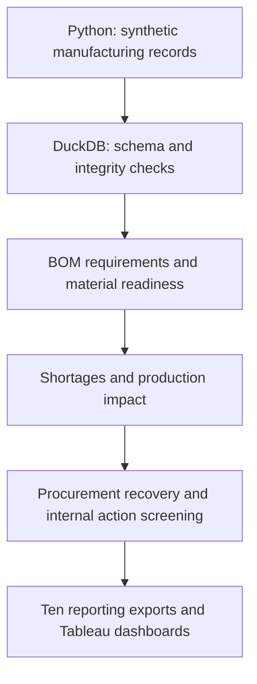
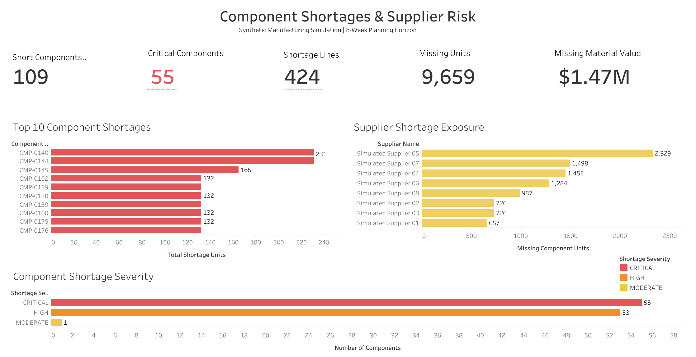

# Manufacturing Readiness & Shortage Intelligence

**Python · SQL / DuckDB · Material Readiness · Procurement Recovery · Tableau**

An independent manufacturing-planning case study using **synthetic aerospace electronics and electromechanical data**. It identifies material constraints on production orders and compares purchasing actions to protect planned starts at a lower modeled premium.

## Key results

| Metric | Synthetic reference case |
|---|---:|
| Production orders / planning horizon | **30 orders / 8 weeks** |
| Baseline material readiness | **10 ready, 8 at risk, 12 blocked — 33.33% ready** |
| Component shortages | **424 exception lines / 109 distinct components** |
| Aggregate order-delay days | **93 → 8 with targeted expediting** |
| Targeted incremental procurement spending | **$154,010.01** |
| Savings versus expediting every shortage line | **$214,500.11** |

The [executive KPI export](data/reporting/executive_kpis.csv) and [recovery comparison](data/reporting/recovery_comparison.csv) support these figures. Delay days are summed across orders, not elapsed calendar days. Savings compare two simulated recovery strategies; they are not realized savings or a reduction below standard purchasing cost.

**Decision:** target the shortage lines that constrain production starts. Targeted expediting achieves the same modeled delay reduction as blanket expediting with **58.2% less incremental spending**. Confirm supplier timing and execution feasibility before using the recommendation operationally.

[Executive summary](docs/executive_summary.md) · [Methodology and rebuild](docs/methodology.md) · [Validation](docs/validation_report.md) · [Tableau workbook](dashboards/Manufacturing_Readiness_Intelligence.twb)

## Business problem and approach

A shortage list alone does not show which production starts are threatened or which purchases improve recovery dates. The analysis connects component demand, inventory allocations, supply timing, and production orders so a planner can distinguish material exposure from actionable schedule constraints.

Python generates reproducible manufacturing records for four product families and eight suppliers. DuckDB SQL explodes the multi-level BOM, calculates material requirements and readiness, prioritizes shortages, and compares standard purchasing, qualified alternates, full expediting, targeted expediting, and internal action screening.

## Dashboards

### Manufacturing readiness

Readiness by order, family, and week identifies where material constraints warrant immediate review.

### Component shortages and supplier risk

The reference case contains 9,659 missing component units with $1,473,979.95 in modeled standard material value. This is missing-material exposure, not an inventory write-off or realized loss.

### Production impact and recovery

Targeted expediting selects 101 shortage lines and leaves two orders delayed. The unaddressed residual delay is part of the recommendation.

## Findings and business judgment

| Planning challenge | Analytical response | Decision implication |
|---|---|---|
| Shared component demand across a multi-level BOM | Explode requirements and respect allocations | Evaluate order-level readiness without double-counting inventory |
| A large shortage list obscures start-date constraints | Relate shortages to modeled production delays | Prioritize components that determine recovery dates |
| Expediting every exception can overspend | Compare full and targeted expediting at the same recovery outcome | Spend on the lines that support the modeled recovery |
| Internal reallocation may transfer a shortage elsewhere | Screen reallocation and resequencing candidates | Treat candidates as proposals requiring detailed feasibility checks |

Material readiness does not establish shop-floor capacity or complete execution readiness. Recovery dates depend on the assumed arrival dates, priorities, and purchasing conditions.

## Repository guide and reproduction

| Location | Contents |
|---|---|
| [Python scripts](scripts/) | Synthetic generation, database build, validation, analytical runners, and export checks |
| [SQL](sql/) | Schema, integrity, BOM requirements, readiness, shortages, production impact, and recovery |
| [Reporting exports](data/reporting/) | Ten CSVs feeding the dashboards and reported findings |
| [Dashboards](dashboards/) | Tableau workbook and three PNG previews |
| [Documentation](docs/) | Scope, assumptions, data dictionary, methodology, executive summary, and validation evidence |

The [rebuild guide](docs/methodology.md#rebuild-from-the-project-root) lists environment setup and the exact execution order. Database files are local generated artifacts and are excluded from Git. Tableau connections may need relinking to the reporting CSVs.

The saved validation report documents 23 manufacturing integrity checks, agreement between ten reporting views and CSVs, and independent reconstruction of headline metrics. Those checks establish internal consistency of the synthetic snapshot; they do not validate real supplier or factory performance.

## Limitations and opportunities

All source records and operating assumptions are synthetic. Material values and procurement premiums are modeled. The analysis does not optimize labor, equipment capacity, detailed routing, or simultaneous factory execution. Internal action screening is not a fully optimized allocation or schedule.

The most useful extensions are capacity-aware recovery, uncertainty in supplier arrivals, protected allocation rules, and validation with actual operating data where authorized. See the [assumptions](docs/assumptions.md) and [scope](docs/project_scope.md) for interpretation boundaries.

## Challenges I Addressed

The main challenge was connecting a component shortage list to order-level recovery decisions while avoiding double-counted inventory and overstated schedule benefits.

| Challenge | How I addressed it | Why it mattered |
|---|---|---|
| Shared component demand runs through a multi-level BOM | I exploded requirements and accounted for inventory allocations when assessing production orders. | Readiness reflected the material requirements of each order and avoided treating reserved inventory as freely available. |
| Shortage volume alone did not identify the production-start constraints | I connected component exceptions to modeled order delays and recovery dates. | Procurement priorities reflected schedule impact as well as material exposure. |
| Expediting every exception could spend more for the same recovery | I compared standard purchasing, full expediting, and targeted expediting against their modeled delay outcomes and incremental procurement spending. | The recommendation favored the targeted strategy under the documented assumptions and retained its residual delays. |
| Internal reallocation could transfer a shortage to another order | I screened reallocation and resequencing candidates rather than presenting them as a fully optimized factory schedule. | Candidate actions remained proposals requiring allocation protection and execution checks. |
| Synthetic findings needed a clear evidence boundary | I reconciled readiness, shortage, purchasing, and recovery exports and disclosed the synthetic records and modeled assumptions throughout the case study. | Internal consistency was distinguished from proof of real supplier performance or realized savings. |

Material readiness does not establish shop-floor capacity or complete execution readiness. Recovery dates depend on the assumed arrival dates, priorities, and purchasing conditions.

## Opportunities for Improvement

1. **Add capacity-aware recovery.** Incorporate labor, equipment, routing, and production constraints to test whether material recovery also supports an executable shop-floor plan.
2. **Test uncertainty in supplier arrivals.** Evaluate recovery robustness under plausible lead-time variation rather than relying only on the reference arrival dates.
3. **Strengthen internal allocation decisions.** Add protected reservations and explicit order-priority rules, then evaluate reallocation and resequencing without shifting unacceptable risk to other orders.
4. **Validate against authorized operating evidence.** Compare the synthetic model's assumptions with actual BOM, inventory, purchase-order, and production records where access is permitted; retain a clear distinction between simulated and observed outcomes.
